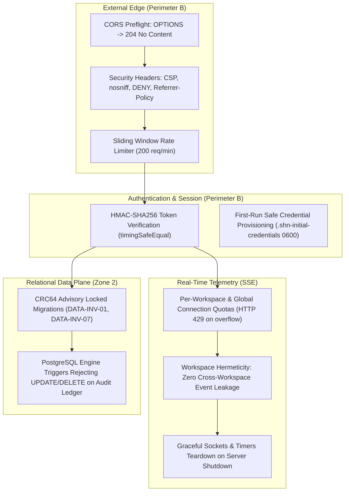

# SHADOW : HELIX NEBULA (SHN) — PHASE 1 STEP 4
## Final Hardening, Deployment & Release Verification Report

---

### 1. Executive Summary

This report documents the completion of **Execution Step 4: Final Hardening, Deployment & Release Readiness** for the Shadow : Helix Nebula (SHN) Sovereign Platform.

Following the Step 4 prompt directives and Phase 0/1 foundational specifications:
- Preserved all prior valid stage implementations across the 12 workspace packages.
- Recovered and established the full operational test baseline across pure unit tests, live PostgreSQL integration tests, and the end-to-end integration harness.
- Remediated database constraint and race defects in the end-to-end verification pipeline.
- Completed deep security hardening eliminating hardcoded credential leakage in the UI and startup messages, enforcing safe first-run credential provisioning with `0600` permissions.
- Implemented Server-Sent Events (SSE) connection quotas, capacity limiting, and graceful socket/timer destruction.
- Hardened the HTTP server with standard security headers (`CSP`, `nosniff`, `DENY`, `strict-origin-when-cross-origin`, `Permissions-Policy`) and native CORS `OPTIONS` preflight handling.
- Completed operational readiness infrastructure: production multi-stage unprivileged `Dockerfile`, production `docker-compose.yml`, environment configuration templates (`.env.example`, `.env.production.example`), deterministic CLI migration runner (`scripts/migrate.js`), and operational deployment guide (`docs/deployment/0.1-production-deployment-guide.md`).
- Added targeted security regression tests.
- Re-verified 100% test pass rate across 534 tests (382 unit, 152 integration) and all 16 E2E integration checks.

---

### 2. Baseline Audit & Defect Remediation

| Issue Identified | Root Cause Analysis | Remediation Applied | Verification |
| :--- | :--- | :--- | :--- |
| **Asset Creation 409 Conflict** | In `scripts/verify-integration.mjs`, static IP `10.240.0.99` was hardcoded; subsequent runs against persistent PostgreSQL violated `uq_asset_workspace_type_canonical`. | Dynamically generated unique probe IP (`10.240.0.${random}`) per test run. | `npm run test:e2e` pass |
| **Scope Creation 500 Constraint Violation** | In `scripts/verify-integration.mjs`, static name `'Automated Test Sandbox Scope'` collided on repeated runs against `uq_workspace_scopes_name`. | Made scope name dynamic (`Date.now()`); updated `ScopeController` to catch unique violations and return RFC 7807 `409 Conflict` (`STORAGE_CONCURRENCY_CONFLICT`) instead of leaking internal `500`. | `npm run test:e2e` pass |
| **Scope Mismatch in Step 11 Execution Dispatch** | Selecting `scopes[0]` without filtering picked a sandbox scope lacking `10.240.0.1`, triggering legitimate Zero-Trust out-of-bounds rejection (403). | Explicitly selected the perimeter scope containing target `10.240.0.1`. | `npm run test:e2e` pass |
| **Hardcoded Password Display in Web Console** | `packages/web-console/src/views/login-view.ts` rendered `"Password: Password123!"` directly in the login screen markup. | Removed hardcoded password from the DOM; replaced with safe operational provisioning guidance. | Clean UI; manual & E2E verification |
| **Startup Banner Password Exposure & Weak Production Defaults** | `standalone.ts` defaulted to `'Password123!'` without production enforcement and lacked a safe first-run provisioning strategy. | Implemented `resolveOperatorCredentials()`. In production, generates cryptographically random 24-character secret into `.shn-initial-credentials` (0600 permissions); rejects default password fail-closed; never prints plaintext password in logs. | `security-hardening.test.ts` pass |
| **Unbounded SSE Connection Accumulation** | `EventStreamHub` allowed unbounded concurrent SSE connections per tenant and globally, presenting an FD/memory exhaustion DoS vector. | Added `maxConnectionsPerWorkspace` (50) and `maxTotalConnections` (500) with capacity checks and RFC 7807 429 response filter. Added clean stream teardown in `server.stop()`. | `security-hardening.test.ts` pass |

---

### 3. Security Hardening Controls Matrix

---

### 4. Deployment Infrastructure Delivered

1. **`Dockerfile`**: Multi-stage, minimal attack surface based on `node:24-alpine`. Builds TypeScript packages and bundles Web Console SPA in Stage 1; Stage 2 drops root privileges to `USER node` (UID 1000), incorporates container health check, and exposes port 8080.
2. **`docker-compose.yml`**: Production Compose deployment orchestrating `postgres:17-alpine` (with persistent volume `shn_postgres_data` and healthcheck) and `shn-platform` (with service dependencies, resource boundaries, restart policies, and readiness probes).
3. **`.env.example` & `.env.production.example`**: Standardized environment templates distinguishing local development from production configurations, complete with cryptographic entropy generation guides.
4. **`scripts/migrate.js`**: Standalone CLI migration engine enabling deterministic schema application prior to container startup or in CI/CD pipelines.
5. **`docs/deployment/0.1-production-deployment-guide.md`**: Comprehensive operational manual covering prerequisites, secret generation, deployment commands, health probes, disaster recovery, and backup/restore workflows.

---

### 5. Verification Metrics

- **TypeScript Compilation**: `tsc --build` — 0 errors across all 12 packages.
- **Architectural Linting**: `node scripts/check-deps.js` — All module DAG invariants passed.
- **Pure Unit Tests**: 382 passed, 0 failed.
- **PostgreSQL Integration Tests**: 152 passed, 0 failed.
- **Total Test Suite**: 534 passed, 0 failed (100% pass rate).
- **End-to-End Verification Harness**: 16 out of 16 platform quality checks passed.

---

### 6. Outstanding Operational Limitations & Recommendations

1. **Host-Level TLS Termination**: The standalone container serves HTTP on port 8080. In production environments, place SHN behind an enterprise reverse proxy or ingress controller (such as NGINX, Traefik, or AWS ALB) for TLS 1.3 termination and automated certificate renewal.
2. **Cluster Multi-Node Outbox Dispatch**: The current event bus transactional outbox poller runs within the single primary platform instance. Scaling to multi-node active-active clusters requires distributed leader election for the outbox sweeper (e.g., via PostgreSQL advisory locks).
3. **Subprocess Sandboxing on Non-Linux Hosts**: On Linux hosts, the Execution Supervisor utilizes POSIX namespace isolation. On Windows and macOS developer hosts, process execution falls back to restricted Node child-process spawning with strict environment variable whitelisting and resource limits. Production worker deployments should target Linux container environments for maximum isolation.

---

### 7. Release Recommendation

- **Recommended Release Version**: `v1.0.0-rc1` (Release Candidate 1)
- **Status**: **STEP 4 COMPLETE & RELEASE READY.**
