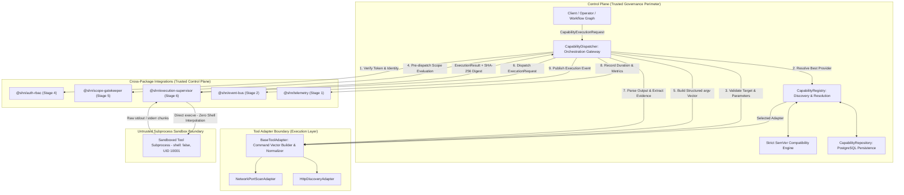

# SHADOW : HELIX NEBULA (SHN) — PHASE 1 STAGE 7
## Capability Registry & Base Tool Adapters Architecture Report

---

### 1. Executive Summary

Phase 1 Stage 7 implements the authoritative capability registry, dynamic tool provider resolution engine, base tool adapter abstraction, and capability execution gateway for Shadow : Helix Nebula (SHN).

Adhering strictly to frozen Phase 0 specifications (Phase 0.3 Context 4 BC-CAP, Context 6 BC-EXE, Phase 0.4 Invariants INV-01, INV-03, INV-04, INV-06 & INV-14, Phase 0.7 Section 4.2.3 `mod_capability_registry`, Phase 0.8 Plugin & Adapter Architecture, Phase 0.9 Tool Integration Architecture Sections 1–12, Phase 0.10 Data Architecture, and Phase 0.14 Perimeter D Section 19), this stage delivers:

1. **`@shn/capability-registry`**: Zero-runtime-dependency core package implementing:
   - Canonical capability manifests and tool adapter manifests with strict declarative validation.
   - Strict SemVer parsing, comparison, and range compatibility engine (`^`, `~`, `>=`, `<=`, `>`, `<`, exact, wildcard).
   - In-memory and PostgreSQL-backed capability registry with hierarchical system-wide and workspace-scoped overrides.
   - Multi-provider capability resolution algorithm dynamically selecting compliant, enabled, and platform-compatible tool adapters with tenant priority overrides.
   - Base Tool Adapter (`BaseToolAdapter`) enforcing direct non-shell command vectoring (`argv[]`), target and parameter sanitization, decoupled output normalization, error classification, and cryptographic raw evidence extraction.
   - Concrete reference adapters: `NetworkPortScanAdapter` (abstract `shn://capabilities/network/port-scan`) and `HttpDiscoveryAdapter` (abstract `shn://capabilities/web/http-discovery`).
   - Capability Execution Dispatcher (`CapabilityDispatcher`) orchestrating end-to-end execution: fail-closed identity verification, multi-tenant workspace isolation (`INV-01`), RBAC permission checks, pre-dispatch Scope Gatekeeper validation (`INV-06`), structured command dispatch to Execution Supervisor (Stage 6), output interpretation, continuous SHA-256 evidence linking, telemetry recording, and domain event publication.
2. **Database Migration `006_capability_registry_and_tool_adapters.sql`**: Forward-only, deterministic migration establishing relational entities in schema `capabilities`:
   - `capabilities.capabilities`: Abstract capability definitions, schemas, requirements, and lifecycle states.
   - `capabilities.adapters`: Registered tool adapter providers, capability bindings, and binary paths.
   - `capabilities.workspace_bindings`: Workspace-level preferred adapter priorities and disable toggles.
3. **Capability Repository**: Robust PostgreSQL repository `CapabilityRepository` in `@shn/data-access` enforcing multi-tenant isolation (`INV-01`, `DATA-INV-08`).
4. **Comprehensive Test Suite**: Pure unit tests, repository integration tests, and end-to-end dispatcher integration tests (429 tests passing platform-wide) with a 100% pass rate.

---

### 2. Architecture & Trust Boundaries

The Capability Registry serves as the bridge between abstract operational capabilities and concrete, sandboxed execution tools while strictly preserving security perimeters:

#### Monorepo Dependency DAG Compliance:
- `@shn/shared-kernel` (Primal leaf — zero dependencies)
- `@shn/error-catalog` (Depends on shared-kernel)
- `@shn/telemetry` (Depends on shared-kernel, error-catalog)
- `@shn/data-access` (Depends on shared-kernel, error-catalog, driver `pg`)
- `@shn/event-bus` (Depends on shared-kernel, error-catalog, data-access, telemetry)
- `@shn/auth-rbac` (Depends on shared-kernel, error-catalog, data-access, telemetry, event-bus)
- `@shn/scope-gatekeeper` (Depends on shared-kernel, error-catalog, telemetry, data-access, event-bus, auth-rbac)
- `@shn/execution-supervisor` (Depends on shared-kernel, error-catalog, telemetry, data-access, event-bus, auth-rbac, scope-gatekeeper)
- `@shn/capability-registry` (Depends on all core platform layers, strictly zero cycles)

Enforced mechanically via `scripts/check-deps.js` during `npm run lint:deps`.

---

### 3. Capability Manifests & Declarative Validation

#### 3.1 Capability Definition Contract (`CapabilityDefinition`)
Capabilities define abstract platform contracts without referencing tool-specific binaries:
- **Canonical ID**: URI format (`shn://capabilities/{category}/{action}`) or UUIDv7.
- **SemVer Version**: Authoritative SemVer string (e.g. `1.0.0`).
- **Category & Risk**: Validated against `RECONNAISSANCE`, `DISCOVERY`, `VULNERABILITY_SCAN`, `EXPLOITATION`, `ANALYSIS`, `REPORTING`, `UTILITY` and risk levels `INFORMATIONAL` to `INVASIVE`.
- **Supported Targets**: `IP`, `CIDR`, `DOMAIN`, `URL`, `HOST`.
- **Permission & Scope**: `requiredPermissions` mask and `requiredScopeAction` string.
- **Platform Compatibility**: `linux`, `darwin`, `win32`.
- **Lifecycle States**: `DRAFT`, `ACTIVE`, `DEPRECATED`, `DISABLED`, `REVOKED`.
- **Cryptographic Digest**: 64-character SHA-256 hex string (`integrityDigest`).

#### 3.2 Tool Adapter Definition Contract (`ToolAdapterDefinition`)
Adapters declare the tooling that implements abstract capabilities:
- **Adapter ID**: Canonical identifier (e.g. `adapter:network-port-scan`).
- **Binary Path Sanitization**: Rejects null bytes (`\0`), shell metacharacters (`;`, `&`, `|`, `` ` ``, `$`, `>`, `<`), path traversal sequences (`..`), and Windows batch scripts (`.bat`, `.cmd`).
- **Supported Capabilities**: Bindings specifying `capabilityId`, SemVer `versionConstraint`, and provider `priority`.
- **Lifecycle States**: `DISCOVERED`, `REGISTERED`, `VALIDATED`, `ENABLED`, `AVAILABLE`, `DISABLED`, `REVOKED`.

---

### 4. Strict SemVer Compatibility & Multi-Provider Resolution

#### 4.1 Strict SemVer Engine
Zero-runtime-dependency implementation of SemVer 2.0.0 parsing, comparison, and constraint satisfaction:
- Parses major, minor, patch, prerelease tags, and build metadata.
- Pre-release precedence handling (prereleases have lower precedence than normal releases).
- Constraint clauses: exact (`1.0.0`), equality (`=1.0.0`), caret (`^1.0.0`), tilde (`~1.0.0`), comparison ranges (`>=1.0.0 <2.0.0`), wildcards (`*`, `x`).
- Full lifecycle compatibility evaluation (`EXACT`, `COMPATIBLE`, `INCOMPATIBLE`, `DEPRECATED`, `REVOKED`, `UNSUPPORTED`).

#### 4.2 Multi-Provider Resolution Algorithm (Phase 0.9 §9)
When a capability execution request arrives, the provider resolver executes the following deterministic heuristic:
1. Resolves capability definition from workspace overrides or system definitions.
2. Asserts capability lifecycle state: fail-closed if `DISABLED` (`ERR_CAP_DISABLED`) or `REVOKED` (`ERR_CAP_REVOKED`).
3. Checks tenant workspace bindings: if disabled in workspace, fails closed with `ERR_CAP_DISABLED`. Extracts workspace preferred adapter if declared.
4. Filters registered adapters on the host node:
   - Must be in `ENABLED` or `AVAILABLE` lifecycle state.
   - Must support the host platform (`process.platform`).
   - Must provide a binding whose SemVer constraint satisfies the capability's version.
5. Calculates candidate priority:
   - Base adapter binding priority.
   - Preference bonus (+10,000) if explicitly requested or configured in tenant workspace binding.
6. Deterministically sorts candidates:
   - Priority descending.
   - Adapter SemVer descending.
   - Adapter name ascending.
7. If no candidate qualifies, fails closed with `ERR_ADAPTER_NOT_FOUND`.

---

### 5. Base Tool Adapter Abstraction & Security Invariants

All concrete tool adapters inherit from `BaseToolAdapter`:

1. **Parameter Validation (`validateParameters`)**: Enforces required argument fields, rejects null bytes (`\0`), and caps parameter strings to 8KB.
2. **Target Validation (`validateTarget`)**: Validates non-empty target strings, rejects null bytes, rejects shell metacharacters, and caps target strings to 2KB.
3. **Structured Command Vectoring (`buildCommand`)**: Produces `CommandVector { executable, args: [...] }`. Operates with `shell: false` exclusively (`TOOL-INV-01`). Zero command string interpolation.
4. **Decoupled Output Normalization (`parseOutput`)**: Parses raw stdout/stderr into typed domain entities without throwing unhandled exceptions (`TOOL-INV-08`).
5. **Deterministic Error Classification (`classifyError`)**: Maps exit codes and error banners to canonical `ExecutionTerminationReason` (`TOOL-INV-10`).
6. **Cryptographic Evidence Sealing (`extractEvidence`)**: Taps raw stdout/stderr and returns content-addressed `EvidenceArtifact` objects linked directly to the ingestion SHA-256 hash (`TOOL-INV-03`).

#### Reference Adapters:
- `NetworkPortScanAdapter`: Binds to `shn://capabilities/network/port-scan`, builds structured arguments (`-T<timing>`, `-p`, `-sT`, target), parses port finding lines, extracts text report evidence.
- `HttpDiscoveryAdapter`: Binds to `shn://capabilities/web/http-discovery`, builds structured arguments (`-s`, `-S`, `-I`, `-L`, `--max-time`, `-A`, url), parses HTTP headers and status codes, extracts raw header evidence.

---

### 6. Capability Execution Dispatcher & Gateway

The `CapabilityDispatcher` coordinates the complete 14-stage execution pipeline:

1. **Identity & Multi-Tenant Assertion (`INV-01`)**:
   - Asserts non-null, unexpired security context token.
   - Asserts token subject matches requested actor ID.
   - Asserts token workspace matches request workspace (`ERR_AUTH_CROSS_WORKSPACE_DENIED`).
   - Verifies workspace belongs to organization via `TenancyValidator`.
2. **Capability Validation**:
   - Resolves capability; verifies workspace tenant scoping.
   - Rejects disabled or revoked capabilities.
3. **RBAC Permission Verification**:
   - Asserts actor's permission mask contains `capability.requiredPermissions`. Rejects unauthorized actors with `ERR_AUTH_FORBIDDEN`.
4. **Provider Resolution**:
   - Resolves best tool adapter using the multi-provider resolver.
5. **Adapter Validation**:
   - Validates target syntax and argument schema.
6. **Pre-Dispatch Scope Gatekeeper Authorization (`INV-06`, `TOOL-INV-02`)**:
   - Evaluates target against active scope (by `scopeId`, `scopeToken`, or `scopeOverride`).
   - Fails closed with `ERR_SCOPE_VIOLATION_OUT_OF_BOUNDS` if target is outside inclusions, matches exclusions, or breaches cloud metadata prohibitions (`SEC-INV-08`).
7. **Command Construction**:
   - Calls `adapter.buildCommand` to generate structured arguments.
8. **Execution Supervisor Dispatch (Stage 6)**:
   - Dispatches execution to `ExecutionSupervisor.execute()`.
   - Runs in isolated scratch directory with sanitized environment (zero host secrets, `INV-14`), process tree kill timers, and continuous SHA-256 evidence sealing.
9. **Output Parsing & Evidence Association**:
   - Parses stdout via adapter parser; associates SHA-256 evidence hash pointer.
10. **Telemetry & Events**:
    - Records execution duration in `capability_execution_duration_ms` histogram.
    - Publishes canonical domain lifecycle event over `EventBus`.

---

### 7. Relational Persistence & Schema Model

Migration `006_capability_registry_and_tool_adapters.sql` establishes three relational tables in the `capabilities` schema:

1. `capabilities.capabilities`:
   - System capabilities (`workspace_id IS NULL`) with unique index on `id`.
   - Workspace capability overrides (`workspace_id IS NOT NULL`) with unique index on `(id, workspace_id)`.
   - Lifecycle check constraint (`DRAFT`, `ACTIVE`, `DEPRECATED`, `DISABLED`, `REVOKED`).
   - Risk check constraint (`INFORMATIONAL`, `LOW`, `MEDIUM`, `HIGH`, `CRITICAL`, `INVASIVE`).
2. `capabilities.adapters`:
   - System and workspace-scoped tool adapter registrations.
   - `supported_capabilities` JSONB array of capability bindings and constraints.
   - Lifecycle check constraint (`DISCOVERED`, `REGISTERED`, `VALIDATED`, `ENABLED`, `AVAILABLE`, `DISABLED`, `REVOKED`).
3. `capabilities.workspace_bindings`:
   - Composite primary key `(workspace_id, capability_id)`.
   - Preferred adapter override (`preferred_adapter_id`).
   - Tenant enablement flag (`is_enabled`).
   - Tenant configuration overrides (`overrides` JSONB).

---

### 8. Security Defense Matrix

| Security Threat / Risk | Architectural Defense Mechanism | Enforcing Component | Verification Test |
| :--- | :--- | :--- | :--- |
| **Command Injection** | Direct `execve` parameter vectoring (`argv[]`); zero system shell interpolation. | `BaseToolAdapter`, `ExecutionSupervisor` | `manifest-validator.test.ts`, `base-tool-adapter.test.ts` |
| **Path Traversal in Binaries** | Strict rejection of `..` in manifest binary paths. | `validateToolAdapterManifest` | `manifest-validator.test.ts` |
| **Windows Batch Execution** | Strict rejection of `.bat` and `.cmd` extensions to avoid implicit `cmd.exe` invocation. | `validateToolAdapterManifest` | `manifest-validator.test.ts` |
| **Null-Byte Injections** | Strict rejection of `\0` in IDs, targets, parameters, and paths. | Manifest Validator, `BaseToolAdapter` | `manifest-validator.test.ts`, `base-tool-adapter.test.ts` |
| **Out-of-Scope Network Scanning** | Pre-dispatch evaluation via `ScopeGatekeeper`; fail-closed default deny. | `CapabilityDispatcher`, `ScopeGatekeeper` | `dispatcher-execution.test.ts`, `capability-dispatcher.test.ts` |
| **Cross-Tenant Contamination** | Strict workspace identity verification and PostgreSQL tenant-scoped queries (`DATA-INV-08`). | `CapabilityDispatcher`, `CapabilityRepository` | `dispatcher-execution.test.ts`, `capability-repository.test.ts` |
| **Secret Leakage in CLI Args** | Environment scrubbing; parameters passed as typed arguments; zero host credentials in env. | `ExecutionSupervisor`, `CapabilityDispatcher` | `security-and-adversarial.test.ts` (Stage 6 integration) |
| **Tampered / Corrupted Evidence** | Continuous SHA-256 output hashing linked to domain entities and artifacts. | `OutputTap`, `BaseToolAdapter` | `dispatcher-execution.test.ts`, `base-tool-adapter.test.ts` |
| **Revoked / Incompatible Tools** | Strict SemVer evaluation and lifecycle checks rejecting revoked or disabled tools. | `StrictSemVer`, `CapabilityRegistry` | `semver.test.ts`, `capability-registry.test.ts` |

---

### 9. Test Suite Verification & Quality Gates

The test suite executed with zero errors, zero warnings, and zero suppressed tests across the entire repository.

#### Test Execution Summary:
- **Unit Tests**: **298 passing** (85 suites, 0 failing, 0 skipped)
  - `@shn/capability-registry`: 67 unit tests (`semver.test.ts`, `manifest-validator.test.ts`, `capability-registry.test.ts`, `base-tool-adapter.test.ts`, `capability-dispatcher.test.ts`).
  - Stages 1–6 packages: 231 unit tests.
- **Integration Tests**: **131 passing** (38 suites, 0 failing, 0 skipped)
  - `@shn/data-access`: `capability-repository.test.ts` (8 integration tests).
  - `@shn/capability-registry`: `registry-persistence.test.ts` (6 integration tests).
  - `@shn/capability-registry`: `dispatcher-execution.test.ts` (4 integration tests).
  - Stages 1–6 packages: 113 integration tests.
- **Total Tests Passing Platform-Wide**: **429 tests across 123 suites**.

#### Quality Gate Audit:
1. `npm run lint:deps`: **PASSED** (0 architectural boundary violations).
2. `npm run build`: **PASSED** (0 TypeScript compiler diagnostics across all packages).
3. `npm run test:unit`: **PASSED** (298/298 passed).
4. `npm run test:integration`: **PASSED** (131/131 passed).
5. `npm test`: **PASSED** (429/429 passed).
6. `git diff --check`: **PASSED** (0 whitespace anomalies or conflict markers).

---

### 10. Stage Status Declaration

PHASE 1 — STAGE 7 COMPLETE.
STAGE 8 NOT STARTED.
