# SHADOW : HELIX NEBULA (SHN) — PHASE 1 STAGE 8
## Ingress Gateway, CLI, OpenAPI 3.1 & Real-Time Event Hub Architecture Report

---

### 1. Executive Summary

Phase 1 Stage 8 establishes the sovereign API Ingress Gateway, unified operator CLI runner, machine-readable OpenAPI 3.1 contract specification (`API-FST-001`, `API-FST-002`), and real-time Server-Sent Events (SSE) telemetry streaming hub (`API-EVT-001`) for Shadow : Helix Nebula (SHN).

Adhering strictly to frozen Phase 0 specifications (Phase 0.3 Perimeter A/B, Phase 0.4 Invariants `INV-01`, `INV-02`, `INV-06`, `INV-09`, `INV-14`, `INV-16`, `INV-19`, Phase 0.7 Section 4.2 `mod_api_gateway`, Phase 0.11 Trust Boundaries, Phase 0.14 Level 2/3 REST, OpenAPI 3.1, and RFC 7807), this stage delivers:

1. **`@shn/ingress-gateway`**: Zero-runtime-dependency core package implementing:
   - Level 2/3 REST routing engine with parameterized path segment parsing, method dispatching, and asynchronous middleware pipeline execution.
   - Comprehensive security and operational middleware: W3C distributed correlation tracking (`correlationId`, `traceId`, `requestId`), IP-based sliding-window rate limiting (`RATE_LIMIT_EXCEEDED`), cryptographic HMAC-SHA256 bearer token validation with browser `EventSource` query parameter support, and strict multi-tenant workspace isolation (`DATA-INV-08`, `WKS-ISO-001`).
   - Domain controllers exposing unified CRUD and lifecycle operations for Health/Metrics, Authentication, Workspaces, Scopes, Assets, Findings, Capabilities, Executions, and Audit.
   - Complete machine-readable **OpenAPI 3.1.0 Contract Specification** (`OPENAPI_3_1_SPEC`) served at `/openapi.json` and `/api/v1/openapi.json` with embedded RFC 7807 Problem Details schemas and nominal typed identifiers.
   - High-throughput **Real-Time Server-Sent Events (SSE) Telemetry Hub** (`EventStreamHub`) delivering live execution progress, finding state transitions, asset discovery alerts, and periodic keep-alive heartbeats with strict per-tenant workspace hermeticity.
   - Sovereign CLI binary runner (`bin/shn.js`) providing automated, headless, scriptable command execution with machine-readable JSON output (`UX-ERG-002`).
2. **Standalone Sovereign Application Server (`standalone.ts`)**: Self-contained runtime bootstrapping PostgreSQL connection pooling (or resilient in-memory fallback), deterministic migration execution, bounded context wiring, static Web Console asset serving, and dual HTTP + SSE service delivery.
3. **Comprehensive Verification**: Pure unit tests, live TCP integration tests, and full end-to-end integration harness (`scripts/verify-integration.mjs`) verifying all 16 platform quality checks.

---

### 2. Architecture & Trust Boundaries

The Ingress Gateway represents Perimeter B (Public & Operator Ingress Boundary) within the SHN Trust Architecture:

```mermaid
graph TD
    subgraph "External Untrusted Zone (Zone 0)"
        WebConsole[Web Console Browser UI]
        OperatorCLI[Headless CLI: bin/shn.js]
        APIClient[Third-Party Operator / SDK]
    end

    subgraph "Ingress Gateway Perimeter (Zone 1 - Perimeter B)"
        Router[HTTP / SSE Router]
        MiddlewarePipeline[Middleware Pipeline: Correlation -> RateLimiter -> Auth -> Tenancy]
        HealthCtrl[HealthController: /health/live, /health/ready, /metrics]
        OpenApiCtrl[OpenApiController: /openapi.json]
        AuthCtrl[AuthController: /api/v1/auth/*]
        WksCtrl[WorkspaceController: /api/v1/workspaces/*]
        ScopeCtrl[ScopeController: /api/v1/workspaces/:id/scopes/*]
        AssetCtrl[AssetController: /api/v1/workspaces/:id/assets/*]
        FindingCtrl[FindingController: /api/v1/workspaces/:id/findings/*]
        CapCtrl[CapabilityController: /api/v1/capabilities/*]
        ExecCtrl[ExecutionController: /api/v1/workspaces/:id/executions/*]
        AuditCtrl[AuditController: /api/v1/workspaces/:id/audit/*]
        EventStreamCtrl[EventStreamController: /api/v1/workspaces/:id/events/stream]
        SSEHub[EventStreamHub: Multi-Tenant Real-Time Broadcaster]
    end

    subgraph "Trusted Control Plane (Zone 2 - Core Domain Packages)"
        AuthRBAC["@shn/auth-rbac (Stage 4)"]
        ScopeGatekeeper["@shn/scope-gatekeeper (Stage 5)"]
        ExecSupervisor["@shn/execution-supervisor (Stage 6)"]
        CapRegistry["@shn/capability-registry (Stage 7)"]
        AssetInventory["@shn/asset-inventory (Stage 9)"]
        DataAccess["@shn/data-access (Stage 2)"]
    end

    WebConsole -->|HTTP REST / SSE Stream| Router
    OperatorCLI -->|HTTP / JSON| Router
    APIClient -->|OpenAPI 3.1 Contract| Router

    Router --> MiddlewarePipeline
    MiddlewarePipeline --> HealthCtrl
    MiddlewarePipeline --> OpenApiCtrl
    MiddlewarePipeline --> AuthCtrl
    MiddlewarePipeline --> WksCtrl
    MiddlewarePipeline --> ScopeCtrl
    MiddlewarePipeline --> AssetCtrl
    MiddlewarePipeline --> FindingCtrl
    MiddlewarePipeline --> CapCtrl
    MiddlewarePipeline --> ExecCtrl
    MiddlewarePipeline --> AuditCtrl
    MiddlewarePipeline --> EventStreamCtrl

    EventStreamCtrl --> SSEHub
    ExecCtrl -->|Publish Event| SSEHub
    FindingCtrl -->|Publish Event| SSEHub
    AssetCtrl -->|Publish Event| SSEHub

    AuthCtrl --> AuthRBAC
    WksCtrl --> DataAccess
    ScopeCtrl --> ScopeGatekeeper
    AssetCtrl --> AssetInventory
    FindingCtrl --> AssetInventory
    CapCtrl --> CapRegistry
    ExecCtrl --> CapRegistry
    ExecCtrl --> ExecSupervisor
    AuditCtrl --> DataAccess
```

---

### 3. Clean Architecture & Strict Dependency Invariants

In strict adherence to `scripts/check-deps.js` and Phase 0 invariants:
- **`MOD-INV-01`**: Strict public facade exports via `src/index.ts`.
- **`MOD-INV-02`**: Strict Directed Acyclic Graph (DAG) dependency hierarchy. Ingress Gateway depends only on domain kernel packages; zero domain package ever imports Ingress Gateway.
- **Zero External Runtime Dependencies**: Standard Node.js `node:http`, `node:url`, `node:events`, and `node:crypto` are utilized exclusively. Zero unvetted third-party framework dependencies.

---

### 4. OpenAPI 3.1 Specification (`API-FST-001`, `API-FST-002`)

The complete OpenAPI 3.1 specification is statically declared and served dynamically at `/openapi.json` and `/api/v1/openapi.json`:
- **OpenAPI Version**: `3.1.0`
- **Security Scheme**: HTTP Bearer format (`bearerAuth`) with HMAC-SHA256 signature verification.
- **RFC 7807 Error Serialization**: Uniform `application/problem+json` schemas for 400, 401, 403, 404, 409, 423, 429, and 500 responses with zero stack trace or secret leakage.
- **Documented Operation Count**: 24 distinct endpoints covering all operational capabilities, tenancy isolation controls, and real-time streams.

---

### 5. Real-Time Telemetry & Event Streaming Hub (`API-EVT-001`)

The Server-Sent Events (SSE) hub enables real-time push communication to operator interfaces:
- **Endpoint**: `GET /api/v1/workspaces/:workspaceId/events/stream`
- **Authentication**: Bearer token via `Authorization` header or `?token=` URL query parameter (enabling native browser `EventSource` consumption).
- **Workspace Hermeticity (`DATA-INV-08`, `WKS-ISO-001`)**: Subscriptions are strictly keyed by `workspaceId`. Clients in `Workspace A` never receive events originating from `Workspace B`.
- **Keep-Alive Heartbeat**: Sends `: ping\n\n` comments every 15 seconds to prevent TCP idle timeouts through proxies and firewalls.
- **Connection Lifecycle**: Tracks connection closures (`req.raw.on('close')`) to cleanly release memory and timers.

---

### 6. Security Defense Matrix

| Threat / Attack Vector | Defensive Control | Enforcing Subsystem | Verification Test |
| :--- | :--- | :--- | :--- |
| **Insecure Direct Object Reference (IDOR)** | Strict multi-tenant `tenancyMiddleware` rejecting cross-workspace entity access with fail-closed 404. | `tenancyMiddleware`, `ScopeGatekeeper` | `gateway-e2e.test.ts`, `verify-integration.mjs` |
| **Unauthenticated API Access** | Mandatory Bearer token validation fail-closed with RFC 7807 401 Problem Details. | `authMiddleware` | `auth-middleware.test.ts`, `gateway-e2e.test.ts` |
| **Tampered JWT / Security Context** | Cryptographic HMAC-SHA256 signature verification rejecting tampered payloads. | `SecurityContextSigner`, `authMiddleware` | `auth-middleware.test.ts` |
| **Denial of Service / Flooding** | Per-IP sliding-window rate limiter rejecting traffic bursts with HTTP 429. | `createRateLimiterMiddleware` | `rate-limiter.test.ts` |
| **Cross-Tenant SSE Stream Leakage** | `EventStreamHub` maps clients strictly by `workspaceId`; zero cross-workspace broadcast. | `EventStreamHub` | `sse-stream.test.ts`, `sse-integration.test.ts` |
| **MIME Sniffing & Clickjacking** | Mandatory `X-Content-Type-Options: nosniff` and `X-Frame-Options: DENY` headers on all responses. | `IngressServer` | `verify-integration.mjs` |

---

### 7. Verification Summary

- **Unit Tests**: `openapi.test.ts`, `sse-stream.test.ts`, `auth-middleware.test.ts`, `rate-limiter.test.ts`, `router.test.ts`, `controllers.test.ts`, `cli-runner.test.ts`.
- **Integration Tests**: `sse-integration.test.ts`, `gateway-e2e.test.ts`.
- **End-to-End Platform Verification**: All 16 checks passing in `scripts/verify-integration.mjs`.

STATUS: STAGE 8 COMPLETE.
