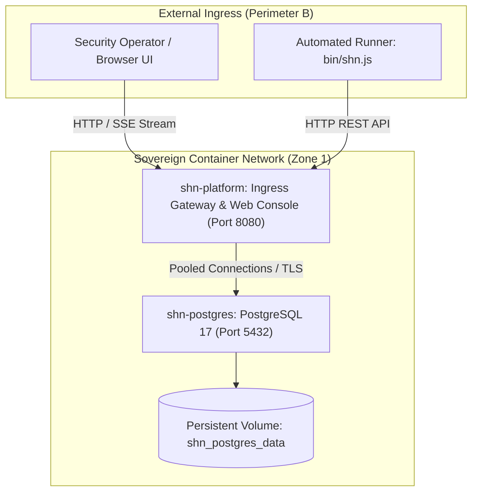

# SHADOW : HELIX NEBULA (SHN) — PRODUCTION DEPLOYMENT & OPERATIONS GUIDE

---

## 1. Overview & Architecture Topology

Shadow : Helix Nebula (SHN) is a sovereign cybersecurity and adversary emulation architecture designed for Zero-Trust environments.

The production deployment consists of two core containerized workloads operating within a closed network boundary:

1. **`shn-postgres`**: PostgreSQL 17 primary relational persistence engine backing tenant workspaces, cryptographic audit trails, identity/RBAC, asset inventory, scope boundaries, and transactional outbox.
2. **`shn-platform`**: Hardened Node.js v24 runtime hosting the Ingress API Gateway (Level 2/3 REST, OpenAPI 3.1), Server-Sent Events (SSE) telemetry hub, execution supervisor, capability registry, and embedded Web Console UI.



---

## 2. Prerequisites & Environment Compatibility

- **Node.js**: `>= 24.0.0`
- **npm**: `>= 11.0.0`
- **Docker Engine**: `>= 24.0.0` with Docker Compose v2 (or local PostgreSQL 17)
- **Host OS**: Linux (Ubuntu 22.04+, Debian 12+, RHEL 9+), macOS 14+, or Windows 11 with WSL2 / PowerShell 7+

---

## 3. Cryptographic Secret Provisioning Procedure

Before deploying to production, generate cryptographically distinct 256-bit (32-byte) secret keys. **Never reuse keys across environments.**

### Generate Secrets via OpenSSL:

```bash
# 1. Signer HMAC secret for SecurityContext tokens (API-INV-01)
openssl rand -hex 32

# 2. Scope boundary HMAC secret for ScopeTokens (SEC-INV-01)
openssl rand -hex 32

# 3. Master database password
openssl rand -base64 32

# 4. Optional: Explicit Initial Operator Master Password
openssl rand -base64 24
```

Copy `.env.production.example` to `.env.production` and configure the generated secrets:

```bash
cp .env.production.example .env.production
```

### Initial Credential Provisioning Policy:
- If `SHN_INITIAL_ADMIN_PASSWORD` is left empty in production, SHN generates a cryptographically random 24-character master password on initial boot and writes it strictly to `.shn-initial-credentials` with `0600` file permissions.
- In production (`NODE_ENV=production`), weak or default passwords (such as `Password123!`) are rejected fail-closed during startup.

---

## 4. Docker-Based Production Deployment

### 4.1 Launch with Docker Compose

Deploy the complete stack with orchestrated health checks and persistent storage:

```bash
# Start PostgreSQL and SHN Platform in detached mode
docker compose --env-file .env.production up -d --build
```

### 4.2 Verify Container Health Status

```bash
docker compose ps
```

Expected healthy output:
```
NAME           IMAGE                    COMMAND                  SERVICE        STATUS
shn-postgres   postgres:17-alpine       "docker-entrypoint.s…"   postgres       Up (healthy)
shn-platform   shadow-helix-nebula-shn  "node packages/ingre…"   shn-platform   Up (healthy)
```

---

## 5. Deterministic Database Migration Workflow

Migrations are executed atomically with CRC64 advisory locks (`DATA-INV-01`, `DATA-INV-07`).

Migrations run automatically during `shn-platform` startup. To run migrations manually or in CI/CD pipeline steps prior to platform startup:

```bash
# Execute all pending migrations
npm run db:migrate
```

To verify migration status:
```bash
node -e "
import { createDatabasePool, getMigrationStatus } from './packages/data-access/dist/index.js';
const pool = createDatabasePool({ host: '127.0.0.1', port: 5432, database: 'shn_primary', user: 'shn_app', password: '...', ssl: false, maxConnections: 1, minConnections: 1, idleTimeoutMs: 1000, connectionTimeoutMs: 1000 });
getMigrationStatus(pool, './packages/data-access/migrations').then(s => { console.log(s); pool.end(); });
"
```

---

## 6. Production Security Hardening & Zero-Trust Invariants

| Defense Subsystem | Implementation | Enforcement Level |
| :--- | :--- | :--- |
| **Non-Root Execution** | Docker container drops root privileges to `USER node` (UID 1000). | OS / Container |
| **HTTP Security Headers** | `Content-Security-Policy`, `X-Content-Type-Options: nosniff`, `X-Frame-Options: DENY`, `Referrer-Policy: strict-origin-when-cross-origin`, `Permissions-Policy`. | Ingress Gateway Server |
| **CORS Preflight** | Native `OPTIONS` handling returning `204 No Content` with configurable origins. | Ingress Gateway Server |
| **SSE Connection Quotas** | Strict per-workspace (default 50) and global (default 500) connection caps with HTTP 429 backoff. | `EventStreamHub` |
| **Resource Boundaries** | CPU (1.5 core limit) and Memory (1024MB limit) enforced via Compose. | Docker cgroups |
| **Tenancy Isolation** | Multi-tenant workspace hermeticity rejecting cross-workspace IDOR access fail-closed (404). | `tenancyMiddleware` |
| **Forensic Audit Integrity** | SHA-256 evidence hashing and immutable database audit logs. | `findings` & `audit_events` |

---

## 7. Operational Observability & Health Probes

SHN exposes standard machine-readable health probes and Prometheus metrics:

### 7.1 Liveness Probe
```bash
curl -f -s http://localhost:8080/health/live
```
Response:
```json
{"status":"UP","timestamp":"2026-10-17T...","version":"0.1.0"}
```

### 7.2 Readiness Probe
```bash
curl -f -s http://localhost:8080/health/ready
```
Response:
```json
{
  "status": "UP",
  "components": {
    "database": { "status": "UP", "latencyMs": 2, "version": "17.10" },
    "memory": { "status": "UP", "heapUsedBytes": 45123984 }
  }
}
```

### 7.3 Prometheus Metrics
```bash
curl -s http://localhost:8080/metrics
```

### 7.4 OpenAPI 3.1 Specification
```bash
curl -s http://localhost:8080/openapi.json
```

---

## 8. Local Development Workflow

For active local development without container overhead:

```bash
# 1. Start isolated PostgreSQL test database on port 54329
npm run db:test:start

# 2. Compile TypeScript packages
npm run build

# 3. Execute all unit and integration tests
npm test

# 4. Run end-to-end platform verification
npm run test:e2e

# 5. Start standalone server with live Web Console
npm run start
```

Access the application in your browser:
- **Web Console UI**: `http://localhost:8080`
- **Vite Hot-Reload Web Dev Server**: `npm run web:dev` (`http://localhost:3000`)
- **API Base URL**: `http://localhost:8080/api/v1`

---

## 9. Graceful Shutdown & Recovery Procedures

### 9.1 Graceful Shutdown
When receiving `SIGINT` or `SIGTERM`, SHN triggers an orderly teardown:
1. Closes HTTP listener to reject new incoming connections.
2. Closes all active Server-Sent Events streams via `eventStreamHub.destroy()`.
3. Drains active worker processes and database connection pools.
4. Flushes telemetry spans and cleanly exits.

To stop the Docker stack cleanly:
```bash
docker compose down
```

### 9.2 Disaster Recovery & Database Backup
```bash
# Create consistent database backup
docker compose exec postgres pg_dump -U shn_app -d shn_primary -F c -f /tmp/backup.dump

# Copy backup to host
docker compose cp postgres:/tmp/backup.dump ./shn_backup_$(date +%Y%m%d).dump

# Restore from backup
docker compose exec -T postgres pg_restore -U shn_app -d shn_primary --clean < ./backup.dump
```
